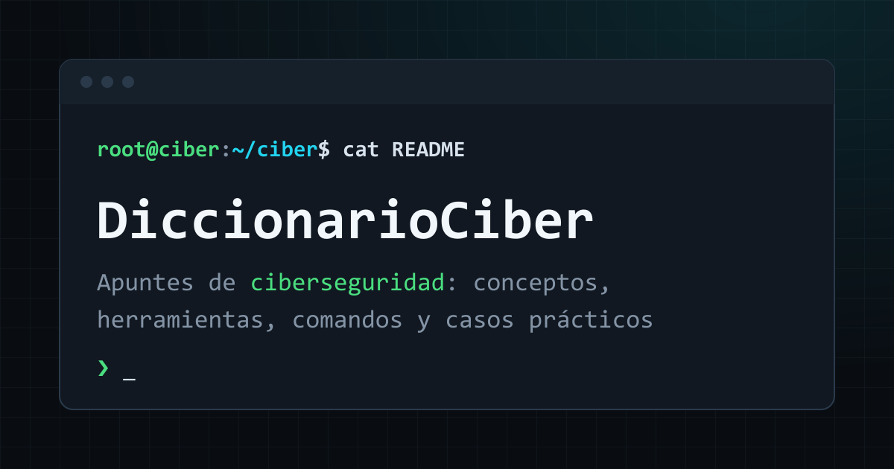

# DiccionarioCiber



Cuaderno de ciberseguridad: los **conceptos** que voy aprendiendo y me resultan
útiles, las **herramientas** con sus comandos y algunos **casos prácticos**,
organizados por las asignaturas del curso y pensados para consultarlos rápido,
también desde el móvil.

Es un proyecto independiente de mi portfolio
([hugoiglesiasdiaz.es](https://hugoiglesiasdiaz.es)).

---

## Índice

- [Características](#características)
- [Stack](#stack)
- [Puesta en marcha](#puesta-en-marcha)
- [Añadir una nota](#añadir-una-nota)
- [Cómo funciona](#cómo-funciona)
- [Publicación](#publicación)
- [Estructura del proyecto](#estructura-del-proyecto)
- [Hoja de ruta](#hoja-de-ruta)
- [Aviso](#aviso)

## Características

- **Notas en Markdown** con frontmatter validado: si una nota está mal
  escrita, el build falla y dice por qué.
- **Filtros combinables** por asignatura y por extras (Herramienta, Comandos,
  Linux, Windows). El estado queda en la URL, así que un listado filtrado se
  puede enlazar.
- **Buscador por palabras clave** sobre el texto completo, comandos incluidos:
  encuentra `--pid` o `windows.pslist`, acepta prefijos (`volat`), ignora
  tildes y tolera erratas leves. Muestra el fragmento donde aparece la
  coincidencia.
- **Tema oscuro y claro**: sigue al sistema hasta que eliges uno con el botón
  de la cabecera, y lo recuerda. Sin parpadeo al cargar.
- **Pensado para el móvil**: barra de navegación inferior, índice de la nota
  en forma de chips y bloques de código con botón de copiar.
- **Notas relacionadas** al final de cada nota, según asignaturas y extras
  en común.
- **Plantillas fijas** para herramientas y casos prácticos, con aviso en el
  build si falta alguna sección.
- **Sin backend**: todo es HTML estático. Incluye sitemap, `robots.txt` y
  vista previa para redes (Open Graph).

## Stack

| Parte | Tecnología |
| --- | --- |
| Framework | [Astro 6](https://astro.build): genera HTML estático |
| Interactividad | Isla de [React 19](https://react.dev) (solo en el buscador) |
| Contenido | Colecciones de contenido de Astro + esquemas con Zod |
| Búsqueda | [MiniSearch](https://lucaong.github.io/minisearch/) con índice precalculado en el build |
| Resaltado de código | Shiki (`github-dark-default` / `github-light-default`) |
| Estilos | CSS propio con variables (sin frameworks) |
| Tipografía | JetBrains Mono (autoalojada) |
| Lenguaje | TypeScript en modo estricto |

## Puesta en marcha

Requiere **Node 22.12** o superior.

```bash
npm install
npm run dev
```

La web queda en <http://localhost:4321>.

| Comando | Qué hace |
| --- | --- |
| `npm run dev` | Servidor de desarrollo con recarga en caliente (muestra también los borradores) |
| `npm run build` | Genera la web estática en `dist/` |
| `npm run preview` | Sirve `dist/` para revisarla antes de publicar |
| `npm run check` | Comprueba tipos y plantillas de Astro |
| `node scripts/generar-og.mjs` | Regenera la imagen para redes (`public/og.png`) |

## Añadir una nota

1. Copia una plantilla de [`plantillas/`](plantillas/):

   | Plantilla | Para | Estructura |
   | --- | --- | --- |
   | `concepto.md` | Conceptos | Libre |
   | `herramienta.md` | Herramientas | Qué es · Para qué sirve · Comandos habituales · Ejemplo práctico · Errores típicos · Advertencias |
   | `caso.md` | Casos prácticos | Contexto · Entorno · Desarrollo · Conclusiones |

2. Guárdala con un nombre en minúsculas y guiones; el nombre del archivo es la URL:

   | Archivo | URL |
   | --- | --- |
   | `src/content/conceptos/nmap.md` | `/conceptos/nmap/` |
   | `src/content/casos/recon-red.md` | `/casos/recon-red/` |

3. Rellena el frontmatter. Mientras tenga `borrador: true` solo se ve en
   `npm run dev`; quítalo para publicarla.

### Frontmatter

```yaml
---
titulo: Volatility 3
descripcion: Framework para extraer artefactos de volcados de memoria RAM.
tipo: herramienta
asignaturas: [forense, incidentes]
extras: [comandos, windows, linux]
etiquetas: [memoria, ram, malware]
actualizado: 2026-11-22
borrador: true
---
```

| Campo | Obligatorio | Valores |
| --- | --- | --- |
| `titulo` | sí | Texto |
| `descripcion` | sí | Una frase, máx. 200 caracteres |
| `tipo` | no | `concepto` (por defecto) o `herramienta`; en `casos/` siempre es `caso` |
| `asignaturas` | sí, al menos una | Ver tabla de abajo |
| `extras` | no | `comandos`, `linux`, `windows` |
| `etiquetas` | no | Palabras clave extra para el buscador |
| `actualizado` | sí | Fecha `AAAA-MM-DD` |
| `borrador` | no | `true` → visible en desarrollo, no se publica |

| id | Asignatura |
| --- | --- |
| `hacking` | Hacking Ético |
| `incidentes` | Incidentes de Ciberseguridad |
| `produccion` | Puesta en Producción Segura |
| `forense` | Análisis Forense Informático |
| `normativa` | Normativa de Ciberseguridad |
| `bastionado` | Bastionado de Sistemas y Redes |

El extra **Herramienta** no se escribe: se añade solo con `tipo: herramienta`.

### Extras de Markdown

- **Cajas destacadas** con la sintaxis de alertas de GitHub:

  ```markdown
  > [!TIP] Título opcional
  > Texto de la caja.
  ```

  Tipos: `NOTE` (nota), `TIP` (consejo), `WARNING` (advertencia) y
  `ERROR` / `CAUTION` (error típico).
- **Bloques de código** con etiqueta de lenguaje y botón de copiar. En los de
  shell (` ```bash `, ` ```powershell `…) el botón omite los comentarios `#`
  y el prompt `$ `. Los bloques ` ```text ` se etiquetan como «salida».
- Los títulos `##` forman el **índice** de la página.
- Los archivos que empiezan por `_` se ignoran.

## Cómo funciona

**Contenido.** Cada carpeta de `src/content/` es una colección con su esquema
en [`content.config.ts`](src/content.config.ts). Las notas se convierten a un
formato común en [`lib/entries.ts`](src/lib/entries.ts), que usan las
tarjetas, los listados, las notas relacionadas y el buscador. Las asignaturas,
extras, tipos y secciones obligatorias de cada plantilla están centralizados
en [`data/site.ts`](src/data/site.ts).

**Búsqueda.** Durante el build,
[`search-index.json.ts`](src/pages/search-index.json.ts) pasa cada nota de
Markdown a texto plano ([`markdown-text.ts`](src/lib/markdown-text.ts)),
separando títulos y código, y genera el índice de MiniSearch como un archivo
estático. El buscador lo descarga al abrir `/buscar/` y no tiene que indexar
nada en el navegador. Las opciones son las mismas en los dos lados gracias a
[`search-config.ts`](src/lib/search-config.ts).

**Temas.** Los colores son variables CSS en
[`global.css`](src/styles/global.css). Un script en el `<head>` pone
`data-theme` en `<html>` antes de pintar la página, según la elección guardada
o la preferencia del sistema.

**Filtros.** El HTML de los listados se genera completo; un script pequeño
oculta las tarjetas que no cumplen los filtros. Sin JavaScript se ven todas
las notas.

## Publicación

La web es estática: `npm run build` genera `dist/`, que se puede servir desde
cualquier hosting estático. Dos variables de entorno controlan la dirección:

| Variable | Para qué | Ejemplo |
| --- | --- | --- |
| `SITE_URL` | Dominio, para URLs absolutas (canónica, sitemap, Open Graph) | `https://apuntes.ejemplo.es` |
| `BASE_PATH` | Ruta base si la web no está en la raíz del dominio | `/` o `/DiccionarioCiber` |

### GitHub Pages

El workflow [`.github/workflows/deploy.yml`](.github/workflows/deploy.yml)
compila y publica la web en cada push a `main`.

1. En el repositorio: **Settings → Pages → Source: GitHub Actions**.
2. Sin más configuración, la web queda en
   `https://<usuario>.github.io/<repositorio>/`.
3. Con dominio propio: crea las variables `SITE_URL` y `BASE_PATH` (`/`) en
   **Settings → Secrets and variables → Actions → Variables** y configura el
   dominio en **Settings → Pages → Custom domain**.

### Otro hosting

Netlify, Cloudflare Pages, Vercel…: comando de build `npm run build`, carpeta
de salida `dist` y las variables `SITE_URL` y `BASE_PATH` como variables de
entorno del build.

## Estructura del proyecto

```
.
├── .github/workflows/deploy.yml   Despliegue en GitHub Pages
├── docs/PLAN.md                   Plan de diseño y fases
├── plantillas/                    Plantillas para nuevas notas
├── public/                        favicon.svg y og.png (imagen para redes)
├── scripts/generar-og.mjs         Genera public/og.png
└── src/
    ├── components/
    │   ├── Header.astro           Cabecera, botón de tema y barra inferior (móvil)
    │   ├── Footer.astro
    │   ├── EntryCard.astro        Tarjeta de una nota en los listados
    │   ├── AsignaturaBadges.astro Insignias de color de las asignaturas
    │   ├── FilterableList.astro   Listado con filtros combinables
    │   ├── Icon.astro             Iconos SVG en línea
    │   └── search/                Buscador (isla de React)
    ├── content/
    │   ├── conceptos/             Conceptos y herramientas (.md)
    │   └── casos/                 Casos prácticos (.md)
    ├── content.config.ts          Colecciones y esquema del frontmatter
    ├── data/site.ts               Identidad, navegación, asignaturas, extras y plantillas
    ├── layouts/
    │   ├── BaseLayout.astro       <head>, metadatos, tema, botón de copiar código
    │   └── EntryLayout.astro      Página de una nota con índice y relacionadas
    ├── lib/
    │   ├── entries.ts             Lectura de las colecciones
    │   ├── markdown-text.ts       Markdown → texto plano para el buscador
    │   ├── remark-callouts.mjs    Plugin de cajas destacadas
    │   ├── search-config.ts       Opciones de MiniSearch (build y navegador)
    │   └── url.ts                 URLs respetando la ruta base
    ├── pages/
    │   ├── index.astro            Inicio
    │   ├── [section]/index.astro  Listados: conceptos y casos
    │   ├── [section]/[slug].astro Página de cada nota
    │   ├── buscar.astro           Buscador
    │   ├── search-index.json.ts   Índice del buscador (generado en el build)
    │   ├── robots.txt.ts
    │   └── 404.astro
    └── styles/global.css          Sistema de diseño (tokens, temas y componentes base)
```

## Hoja de ruta

- [x] Modelo de contenido: conceptos, herramientas y casos prácticos
- [x] Filtros por asignatura y extras, notas relacionadas
- [x] Tema claro
- [x] Búsqueda por palabras clave en el texto completo
- [x] Preparación para publicar (sitemap, Open Graph, despliegue)
- [ ] Búsqueda semántica en el navegador (Transformers.js con un modelo
      multilingüe y embeddings precalculados en el build)

El detalle está en [docs/PLAN.md](docs/PLAN.md).

## Aviso

Contenido con fines **educativos**. No incluye material del curso con
derechos de autor ni soluciones de exámenes. Los datos de los ejemplos (IPs,
hashes, nombres de equipos y usuarios) son **ficticios**; las IPs usan los
rangos reservados para documentación (RFC 5737).

Usa las técnicas y herramientas descritas solo en sistemas propios o con
autorización expresa.
